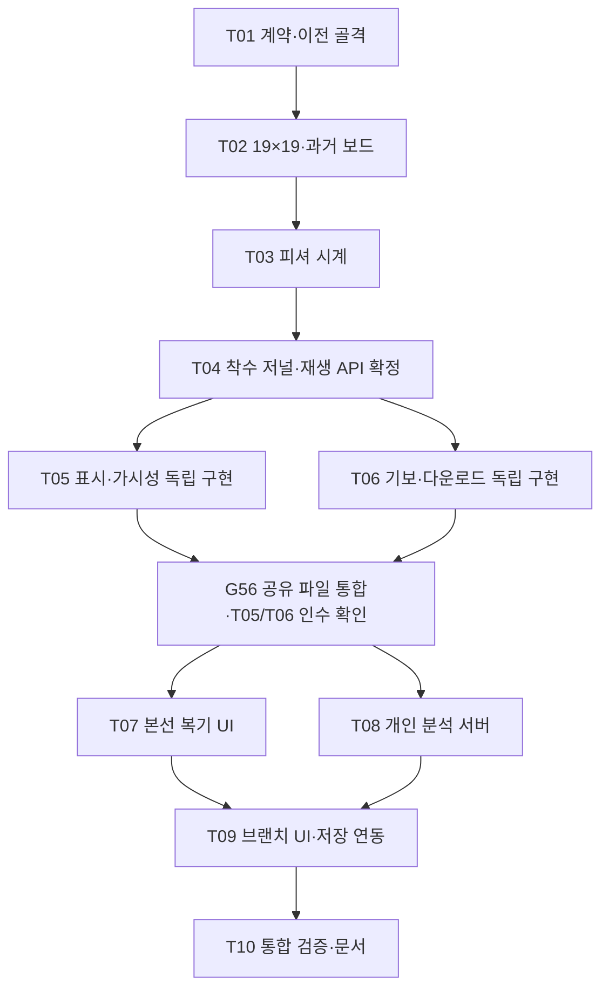

# 19×19·피셔 시계·기보 및 브랜치 분석 실행 계획

**결론: 새 대국을 19×19와 커스텀 피셔 시계로 전환하고, 확정 착수의 원자적 기록을 바탕으로 마지막 착수 표시·기보 목록·복기·종료 후 개인 브랜치 분석을 제공한다. 기존 20×20 데이터는 원형 보존한다. 저장 계약과 이전 경로를 먼저 확정한 뒤 보드 → 시계 → 착수 기록 → 열람·복기 → 브랜치 순서로 구현한다.**

- 유형 / 등급: **Technical Plan / Execution**.
- 작성일: 2026-11-24.
- 실행 상태(2026-11-25): 구현 `eabafd1a0f`, 리뷰 수정 `76d066b78a`. 타입·빌드·전체 브라우저 75개 및 최종 수정 경로 15개 검사 통과, 독립 리뷰 지적 해소. 아래 조사 결과는 구현 전 기준이며 실행 증거는 `.outline/sdd/feedback-final-report.md`에 남긴다.
- 승인 근거: 본 대화의 피드백 5개, 기보·브랜치에 대한 두 차례 응답, `planning_context=confirmed`. [S01][S02]
- 변경 권한: 계획 작성 이후 사용자가 구현·검증·선택적 커밋·기능 브랜치 게시를 승인했다. 실제 운영 DB 교체, main 병합, 배포는 제외한다. 미리보기 서버는 별도 DB를 사용한다.
- 실행 조정: 사용자가 T01–T04의 순환하는 중간 인수 기준을 하나의 기반 관문으로 묶는 것과 모델 지정 미지원 하네스를 승인했다. 파일 소유권과 확정 인터페이스로 규칙·서버·웹을 분리했고, 결합된 protocol v2 전환은 빌드 가능한 원자적 커밋으로 통합했다.

## 1. 목표와 범위

### 확정된 사용자 경험

1. 새 대국은 **19×19 교차점**, 좌표는 기존 표기법을 이어 **A1–S19**로 표시한다. 군사 20개·체스기물 4개, 식량, 두 줄 승리, 장목 선택, 보호 규칙은 유지한다. [S01][S03]
2. 방 생성자가 **기본 시간의 분·초와 수당 증가 초**를 입력한다. 양쪽이 준비 전에 설정을 확인하며, 생성된 방의 설정은 고정한다. 턴마다 초기화하는 60초 제한을 없앤다. [S01][S02][S15]
3. 마지막으로 서버가 확정한 배치·이동의 **도착점**을 돌 바깥 모서리 표식으로 표시한다. 미확정 선택과 구별하며 재접속에도 유지한다. [S01]
4. 대국 중 확정 착수 목록을 보고, 종료·중단 후 본선을 복기한다. 종료 시각부터 **7일** 동안 자신의 과거 대국을 다시 열고 JSON으로 내려받는다. [S01][S02]
5. 종료·중단 대국의 임의 본선 수순 또는 기존 분석 분기에서 **양쪽 수를 직접 두는 브랜치**를 만든다. 실제 규칙을 적용하지만 분석 시계는 돌리지 않는다. 본선은 불변이고, 개인 브랜치도 같은 대국 만료 시각까지 서버에 보관한다. [S01][S02]
6. 군사는 중앙 점 없는 흑백 돌로 표시한다. 룩·비숍·나이트·퀸의 종류 아이콘과 보호·왕관 표시는 유지한다. [S01]

### 명시적 제외

- 계정, 닉네임을 이용한 세션 복구, 다른 기기로의 소유권 이전.
- AI 상대·추천 수·평가 점수, 대국 중 가상 분석, 실전 무르기·본선 편집.
- 다른 사람의 개인 브랜치 공유, 주석·브랜치 이름 편집 등 별도 편집 제품.
- JSON 파일 가져오기, PGN/SGF 호환, 외부 사이트 연동. 다운로드는 이 앱의 버전 있는 JSON이다.
- 보드 크기를 사용자가 선택하는 기능, 임의 크기 엔진, 새로운 게임 규칙.
- 서버 재시작 후 실전 재개, 배포·인프라·의존성 업그레이드.

위 경계 중 계정·AI·대국 중 분석·파일 가져오기 제외는 승인된 맥락 브리핑에 포함되었다. 나머지는 요청하지 않은 기능을 추가하지 않기 위한 구현 경계다. [S01][S02]

## 2. 조사 결과와 기존 계획의 충돌

### 현재 구현에서 확인한 사실

| 영역 | 현재 근거 | 이번 변경의 의미 |
|---|---|---|
| 보드 | `SIZE=20`, 프로토콜 셀 `0..399`·배열 길이 400, `Match`의 400칸 순회 | 상수뿐 아니라 엔진·검증·화면·테스트를 함께 바꿔야 한다. [S04][S05][S06] |
| 입력·그림 | `BOARD_EXTENT=1000`, margin 25, step 50; SVG 격자 끝점 975 고정 | 그림과 클릭·터치·키보드 좌표가 같은 크기 계약을 사용해야 한다. [S06][S07] |
| 돌 표시 | 군사도 SVG 원형 아이콘을 그리며 돌과 반대 색을 적용 | 군사의 보드 중앙 아이콘만 없애고 종류 식별이 필요한 체스 아이콘은 남긴다. [S06] |
| 시계 | 한 개의 `turnRemainingMs`, 매 턴 60초 재설정, 별도 180초 복귀 예산 | 피셔용 양측 잔여 시간으로 교체하되 연결 상태 기계는 유지한다. [S08] |
| 저장 | DB `user_version=1`, snapshot `version=1`, 방 snapshot와 명령 영수증을 함께 커밋 | 스키마 이전과 착수 저널이 필요하다. 현재 `openStore`는 다른 DB 버전을 거부한다. [S09] |
| 열람 | 세션의 최근 방으로 이동하고 대국 화면에는 현재 보드만 표시 | 과거 대국 목록과 실전 연결에 영향을 주지 않는 열람 경로가 필요하다. [S10] |
| 보관·인증 | 종료 7일 후 방·영수증 삭제; HttpOnly 익명 세션으로 접근 | 기보·개인 분석에도 같은 소유권과 만료 정책을 적용한다. [S03][S09][S11] |

### 이전 계획을 대체하는 부분

- 기존 온라인 계획의 `20×20`, `Cell=y*20+x`, 턴당 `60,000ms`, 결과는 복구·판정용으로만 보관한다는 범위를 새 요구로 대체한다. 이전 계획이 기보 제품의 구현 근거가 될 수는 없다. [S16: G01/G08/G14, §1 제외 범위, §3–4]
- 기존 PC 계획의 “UI만 변경, 서버·프로토콜 불변”은 그 작업의 범위였으며 이번 요청에는 적용하지 않는다. [S17: 전역 제약·비목표]
- “종료 후 입력 금지”는 **실전 명령 금지**로 유지한다. 별도 분석 경로에서만 가상 착수를 허용한다. [S16: UI; S17: DOM 계약; S01]
- 유지할 계약: 순수 공용 규칙 엔진, 서버 최종 판정, 동일 명령의 한 번 적용, 저장 후 통지, 재시작 시 중단, 익명 세션 권한, PC 전술석과 모바일 조작. [S03][S08][S12][S16][S17]

### 조사 점검

- 기존 `plans/`의 두 계획 전체를 읽고 상충·유지 항목을 대조했다. [S16][S17]
- 엔진·프로토콜·DB·HTTP·세션·보드·입력·화면 전환·기존 테스트를 읽었다. `SIZE`와 `applyAction` 소비자는 LSP references로 확인했다. [S04–S14]
- Chess.com 공식 도움말에서 기본 시간 **분·초**, 증가 시간 **초**라는 커스텀 입력 의미를 확인했다. 공식 문서는 이 앱의 상한값을 정해 주지 않는다. [S15]
- 메모리는 과거 게시 상태의 참고 정보로만 취급했다. 현재 브랜치나 작업 트리가 깨끗하다는 가정은 두지 않았다.
- 실제 `data/` DB의 내용·건수·과거 기보 복원율은 조회하지 않았다. 테스트 통과율·성능 수치·실기기 결과를 측정했다고 주장하지 않는다.

## 3. 구현 계약

아래에서 ‘결정’은 승인된 요구 또는 이 계획의 구현 선택이고, ‘현재’는 출처에 있는 관찰이다.

### 3.1 보드 크기와 좌표

**결정**

- 새 대국 생성값은 19로 고정한다. 과거 데이터의 해석을 위해 내부 `BoardSize`는 `19 | 20`, 게임 상태에는 명시적 `boardSize`를 둔다. 클라이언트의 방 생성 입력으로 크기를 받지 않는다.
- `createGame`, `validCell`, `cellLabel`, `canMove`, `findLines`, `hasLegalAction`, `applyAction`은 해당 상태의 크기를 일관되게 사용한다. 전역 크기와 데이터 크기를 섞지 않는다. 종료 상태를 반환하는 경로에서도 `boardSize`를 보존한다.
- 선형 셀은 `row * boardSize + column`. 새 대국의 마지막 셀은 360, 361 이상은 거부한다. 과거 20×20의 399는 그대로 T20이다. 군사 수 20은 보드 폭과 다른 규칙이므로 치환하지 않는다.
- SVG 좌표계는 기존 margin=25, step=50을 유지하고 `extent=2*margin+(boardSize-1)*step`으로 계산한다. 19×19의 extent는 950, 마지막 교차점 중심은 925이다. 이는 기존 상수와 새 크기로 계산한 설계값이다. [S07]
- 격자선·라벨·표식·터치 hit-test·키보드·확대 모두 같은 geometry를 사용한다. `975`, `1000`, `400`, `399`를 의미 확인 없이 일괄 치환하지 않는다.
- 활성 대국의 공개 명령은 19×19로 제한한다. 과거 기록 스키마는 자신의 크기에 맞춰 보드 길이·행동·보호 줄을 검증한다. 과거 기록 지원 때문에 실전의 361–399 좌표까지 허용하지 않는다.

### 3.2 저장·프로토콜 이전

**결정: 최종 변경 묶음은 DB v2 / 저장 snapshot v2 / 실전 protocolVersion 2로 한 번에 전환한다. 중간 구현 상태를 기존 서비스에 배포하지 않는다.**

1. 기존 v1을 읽는 전용 이전 경계를 둔다. 새 스키마로 먼저 파싱해서 과거 400칸 데이터를 탈락시키지 않는다.
2. 이전은 SQLite 트랜잭션 하나로 수행하며 성공 마지막에 `user_version`을 갱신한다. 실패하면 원래 행·버전이 그대로 남고 시작을 실패시킨다. 조용히 방을 지우거나 새 DB로 대체하지 않는다.
3. 기존 종료·중단 대국의 20×20 보드, 자원, 보호 줄, 결과, 종료 시각, 소유권, 원본 영수증을 보존한다. 과거 시계 정책은 `legacy-turn`으로 표시하며 피셔로 바꾸어 기록하지 않는다.
4. 기존 진행·일시정지 대국은 기존 재시작 정책대로 `server-interrupted`로 중단한다. 기존 대기 방은 기보가 없으므로 새 19×19·기본 피셔 설정으로 전환하고 준비·연결 상태를 초기화한다. 이미 종료된 대국의 `endedAt`은 갱신하지 않는다. [S03][S09]
5. 새 실전 데이터에는 피셔 계약만 사용한다. 과거 시계 데이터는 종료 기록용 판별 유니온으로 분리하고 새 실전에 구형 타이머를 남기지 않는다.
6. v1 미확정 명령을 v2 명령으로 자동 변환·재전송하지 않는다. 오래된 클라이언트에는 버전 불일치를 명시하고 새로고침을 안내한다. 새 클라이언트는 구형 pending을 발견하면 전송하지 않고 최신 확정 상태를 보여 준다. 기존 영수증은 데이터 보존·복원용으로 남긴다.
7. 운영 DB를 직접 실험하지 않는다. 후속 구현 검증은 테스트 fixture와 SQLite backup API로 만든 일관된 복사본에서 수행한다. WAL 사용 중 본체 파일만 복사하는 방식은 금지한다. [S03][S09]

**과거 기보 복원**

- 영수증 중 실제 수락된 `action`만 `applied_revision` 순으로 읽고, 좌석 소유권으로 진영을 결정한다. `ready`나 연결 변화는 착수가 아니다. revision의 빈 번호를 누락 착수로 가정하지 않는다.
- 과거 크기 20으로 초기 상태부터 `action + claimedLines`를 재생하고 보드·자원·보호 줄·규칙 결과를 최종 snapshot과 비교한다. 시간패·접속패·서버 중단은 착수와 별도의 종료 원인으로 비교한다.
- 원본 출처에 따라 `historyStatus: native | reconstructed | unavailable`을 기록한다. 복원 성공도 새 네이티브 기보와 구분한다. 저장되지 않은 착수 시각·소요 시간·과거 양측 시계는 `null/알 수 없음`이다.
- 복원이 실패한 행은 원본을 보존하고 원인을 기록한다. UI와 JSON에 **최종 보드만 제공**한다고 명시한다. 없는 수순을 만들거나 빈 기보를 완전한 기보처럼 표시하지 않는다. 이 제한은 사용자 브리핑에서 승인받았다. [S02]
- 복원 가능한 기록은 복기·브랜치 분석을 지원한다. `unavailable` 기록은 수순 복기·브랜치 버튼을 비활성화하고 이유를 표시한다.

### 3.3 커스텀 피셔 시계

**설정 계약 — 승인된 앱 정책이며 Chess.com의 상한 복제 주장이 아니다.** [S02][S15]

- 기본값: 10분 + 5초.
- UI: 기본 분 `0..180`, 기본 초 `0..59`, 증가 초 `0..180`. 합산 기본 시간은 **1초 이상, 180분 이하**여야 한다.
- 전송·저장: `timeControl: { baseMs, incrementMs }`. 각각 정수·유한수·1,000의 배수, `baseMs ∈ [1000,10800000]`, `incrementMs ∈ [0,180000]`.
- `Lobby → App → api.createRoom → POST /api/rooms → lobby.create`로 전달한다. 현재 생성 경로는 빈 본문을 사용하므로 전체를 바꾼다. [S10]
- 설정은 생성 시 확정한다. 준비 전 변경 UI/명령을 추가하지 않는다. 같은 세션의 생성 재시도가 기존 방을 반환하면 기존 설정을 유지한다. 참가 요청은 설정을 덮어쓸 수 없다.

**시계 상태·계산 계약**

- 피셔 시계는 양측 `clockRemainingMs: { black, white }`와 서버 전용 `deadlineMonoMs`로 표현한다. 기존 실전의 단일 `turnRemainingMs`를 제거하고 모든 소비자를 이전한다.
- 대기 중에는 시간이 흐르지 않는다. 두 사람이 준비·연결되면 양측을 기본 시간으로 초기화하고 흑의 시계를 시작한다. 시작 증가 시간은 없다.
- 판정 시각 `now`를 한 번 취한다. 활성 진영의 유효 잔여 시간은 `deadline-now`, 비활성 진영의 시간은 저장값이다.
- **`now >= deadline`이면 시간패가 먼저다.** 늦은 착수가 증가 시간으로 살아나지 못한다. 타이머 콜백이 지연되어도 명령 처리 시 만료를 먼저 정산한다. [S08]
- 합법적 확정 수마다 착수자의 실제 잔여 시간에 증가 시간을 정확히 한 번 더한다. 상대는 자신의 남은 시간에서 시작한다. 초기 기본 시간으로 리셋하거나 기본 시간 상한으로 자르지 않는다.
- 승리하는 마지막 합법 수에도 증가 시간을 더한 후 양측 시계를 정지한다. 잘못된 수, 미리보기, 준비, stale 요청, 중복 재전송, 재접속에는 증가 시간을 주지 않는다.
- 장목 구간 선택도 실전 생각 시간에 포함한다. 전송 전 사용자가 시간을 멈추거나 클라이언트 시각으로 판정을 바꿀 수 없다.
- 동일 영수증 재조회는 기존 ACK를 돌려주고 시계·기보를 다시 적용하지 않는다. DB 저장 실패 때도 시간 증가·착수·기록 중 일부만 남으면 안 된다. [S08][S09]

**연결과 표시**

- 어느 한쪽이 끊겨도 활성 시계를 서버의 원래 감지 시각에서 멈춘다. 둘 다 돌아왔을 때 남은 시간으로 재개한다. 각자의 누적 복귀 예산 180초, 먼저 소진한 쪽 패배, 동시 소진 중단을 유지한다. [S08]
- 서버 재시작은 대국 중단이다. 이전 프로세스의 monotonic deadline을 새 프로세스에서 사용하지 않는다. 중단 기록의 시간은 **마지막 커밋 체크포인트**이며 정확한 크래시 시각의 시계라고 표시하지 않는다.
- 화면에는 양측 시계와 설정을 표시한다. `active`일 때 현재 진영만 로컬 monotonic 시간으로 보간하고, `paused/finished/aborted`에서는 멈춘다. 브라우저의 0 표시는 승패 판정이 아니다.
- 복귀 예산은 대국 시계와 별도로 표시한다. 단일 60초 설명은 로비·푸터·대기 화면·결과 문구·README·CHANGELOG에서 함께 갱신한다. [S08][S10][S18]

### 3.4 착수 저널과 마지막 착수

**결정: 명령 영수증을 사용자 기보로 직접 노출하지 않고, 수락된 착수만 별도 저널에 남긴다.** 현재 영수증은 재시도·원자성에 필요한 내부 계약이다. [S08][S09]

- 제안 테이블 `match_moves`: `(room_code, ply)` 기본키, 적용 revision, actor, action, claimedLines, 확정 시각, 소요 시간, 착수 후 양측 잔여 시간. 과거 복원 행의 없는 시간은 nullable이다.
- `ply`는 1부터 연속하는 **착수 번호**이며 room revision과 다르다. 포획된 기물과 자원 변화는 서버의 착수 전후 상태에서 계산해 제공한다. 클라이언트가 포획·시계·승자를 입력하지 않는다.
- 한 수에 대한 **보드·자원·보호 줄·시계·ply/lastMove·저널 행·명령 영수증**을 동일 SQLite 트랜잭션에서 커밋한다. 이후에만 snapshot/ACK를 보낸다. 둘의 전송 순서는 기존처럼 고정하지 않는다. [S08]
- 실패·중복 수·선택 변경·재접속·시간 초과는 착수 행을 추가하지 않는다. 결과와 종료 시각은 별도 메타데이터로 보존한다. 시간패를 가상의 패스 수로 만들지 않는다.
- 공개 room snapshot에는 `moveCount`와 작은 `lastMove`만 추가한다. 전체 기보나 개인 분석 트리를 매 snapshot에 넣지 않는다.
- `lastMove`는 같은 커밋에서 갱신되고 저널 마지막 행과 일치한다. UI는 `place*.at` 또는 `moveChess.to`를 표시한다. 수가 없으면 표식이 없다.
- 미리보기 때문에 돌 위치가 임시로 달라져도 표식은 마지막 **확정 좌표**에 남는다. 선택·보호·왕관과 겹칠 때도 모양을 구별하고 접근성 라벨에 ‘마지막 확정 착수’를 추가한다.

### 3.5 기보 API·보관·다운로드

**제안 인터페이스** — 이름은 이 계획의 신규 계약이며 현재 존재하는 API가 아니다.

| 메서드·경로 | 계약 |
|---|---|
| `POST /api/rooms` | 필수 `timeControl`; 새 방은 19×19. 기존 빈 본문 계약 제거. |
| `GET /api/records` | 현재 세션이 참가한 종료·중단 대국 목록. 종료 시각·코드의 안정적 cursor, 기본 20/최대 100개. |
| `GET /api/records/:code` | 참가자·크기·설정·결과·만료 시각·historyStatus·수 개수·기록 버전. |
| `GET /api/records/:code/moves?afterPly=…&limit=…` | 본선 착수 목록, 기본/최대 200수. 대국 중에도 당사자는 확정된 수만 읽는다. |
| `GET /api/records/:code/analysis?cursor=…` | 요청자 자신의 분석 노드만 페이지 조회. 기본/최대 200개. |
| `POST /api/records/:code/analysis/nodes` | 아래의 개인 분석 노드 한 개 추가. 종료·중단 대국만 허용. |
| `GET /api/records/:code/download` | JSON attachment. 본선·결과·자신의 저장된 분석 포함. 종료·중단 대국만 제공. |

- 모든 경로는 기존 세션 쿠키 인증과 참가자 검사를 거친다. 분석 owner는 서버가 인증 세션에서 정한다. 상대의 분석, 세션 ID·토큰·토큰 해시·내부 영수증을 응답과 다운로드에 넣지 않는다. [S11][S12]
- 만료는 `endedAt + 7일`로 고정한다. 조회·브랜치 추가·다운로드는 이를 연장하지 않는다. cleanup 주기 이전이라도 만료된 기록에 접근할 수 없게 읽기·쓰기 경계에서 확인한다.
- 방 삭제 시 착수와 분석 노드는 FK cascade로 같이 삭제한다. 세션 갱신과 대국 보존 기간을 혼동하지 않는다. 쿠키 삭제·세션 상실 뒤 닉네임만으로 복원하지 않는다. [S03][S09][S11]
- 기보 목록은 `moveCount`를 기준으로 누락된 수만 가져온다. 재접속·응답 역전 때 `ply`로 중복 제거하고 오래된 요청 응답을 다른 대국 화면에 적용하지 않는다.
- 다운로드는 `formatVersion`, 규칙 식별자, boardSize, 진영·닉네임, 시간 설정, 본선 행동/보호 선택, 시간 기록, 결과/만료, historyStatus, 개인 분석 노드를 포함한다. 서버 내부 식별자는 제외한다.
- 다운로드 시 본선과 개인 노드 집합은 하나의 일관된 조회 시점으로 정한다. HTTP body 제한을 없애거나 실전 WebSocket 메시지에 전체 JSON을 실어 나르지 않는다. 현재 HTTP/WS 입력 제한 16,384바이트는 유지한다. [S12]
- 파일 가져오기는 만들지 않는다. JSON은 장기 파일 보관을 위한 명시적 버전 포맷이며, 서버 보관 연장이나 계정 백업을 의미하지 않는다. [S02]

### 3.6 복기와 개인 브랜치

**공용 규칙 재사용**

- 제안 `src/game/replay.ts`에서 초기 게임 + 순서 있는 `{ actor, action, claimedLines }`를 기존 `applyAction`으로 재생한다. 복기 전용으로 이동·식량·장목·승리 규칙을 다시 구현하지 않는다. 현재 엔진은 이 행동들을 순수 함수로 처리한다. [S04]
- 본선 복기 커서는 `0..moveCount`. 시작/이전/다음/끝 및 목록 수 선택으로 보드·자원·보호 줄·해당 수 표식을 함께 갱신한다.
- 저장된 시계는 읽기 전용으로 보여 주며 흐르지 않는다. 복원 기보의 `null`은 0초가 아니라 ‘기록 없음’이다.
- 실전 외부 종료 사유와 규칙상 종국을 구별한다. 시간패·접속패·서버 중단된 위치는 시계 없는 분석을 이어갈 수 있지만, 두 줄 승리·합법 수 없음으로 규칙상 끝난 노드 이후에는 수를 추가하지 않는다.

**분기 모델·권한**

- 제안 `analysis_nodes`: 소유자 세션 + 대국 + nodeId, 부모 참조, action, claimedLines, 생성 순서/시각. 부모는 **본선 ply 하나 또는 같은 소유자의 기존 분석 nodeId 하나**다. JSON 한 덩어리로 트리를 덮어쓰지 않는다.
- 새 노드만 추가하고 기존 부모·행동은 바꾸지 않는다. 부모 존재·같은 대국·같은 소유자를 검증하므로 다른 사람의 노드 참조와 순환 참조를 허용하지 않는다.
- 서버는 부모의 규칙 상태를 재생하고 그 상태의 차례에 맞춰 검증한다. 분석 요청자의 실제 흑/백 좌석으로 분석 진영을 제한하지 않는다. 사용자가 양쪽 수를 직접 두되 순서는 게임 규칙을 따른다.
- `POST` 입력은 클라이언트 생성 UUID nodeId, 부모, action, claimedLines뿐이다. 같은 ID·같은 내용 재시도는 기존 노드를 반환하고, 같은 ID·다른 내용은 충돌이다. 저장 실패나 ACK 유실로 분기가 중복되지 않는다.
- 다른 노드의 동시 추가는 서로 덮어쓰지 않는다. 부모는 불변이므로 전체 트리 revision을 새로 만들 필요가 없다.
- 분기는 본선과 다른 표시로 식별하고 여러 자식 분기와 중첩 분기를 전환할 수 있게 한다. ‘본선으로 돌아가기’는 분석을 본선에 적용하지 않는다.
- 저장 중·저장 실패·확정 저장 상태를 구별한다. 저장 ACK 전에는 ‘보관됨’으로 표시하지 않으며 실패한 수는 같은 ID로 다시 저장할 수 있다. 페이지 종료 전 미저장 분석이 있으면 경고한다.
- 실전 `RoomSnapshot`을 가짜로 만들어 분석 화면에 주입하지 않는다. `Board`, `PieceTray`, `LinePicker`와 자원 표시의 필요한 입력만 재사용하고, 실전 네트워크 상태와 분석 상태는 분리한다.

### 3.7 화면 경로와 시각 계약

- 로비에 ‘내 기보’를 추가하고 `/records`, `/records/:code`를 실전 `/room/:code`와 구분한다. 기보 경로에서 `joinRoom`, 실전 WebSocket 접속, 최근 방으로 자동 리다이렉트를 실행하지 않는다. 기존 앱의 자동 입장 경로와 충돌하지 않도록 분기한다. [S10]
- 대국 중에는 제한된 높이의 착수 목록만 추가한다. 종료 화면에서 전체 복기·분석으로 이동한다. 실전 확정 버튼을 기보 목록이 밀어내지 않도록 한다.
- 기존 PC 기준인 너비 1200·높이 640 이상 3열, 좁은 화면의 문서 흐름, 확대 시 보드 내부 스크롤, 키보드 선택·명시적 확정을 유지한다. [S17]
- 군사 중앙 점 제거는 **보드에 놓인 군사**에 적용한다. 배치 메뉴의 군사 아이콘은 의미를 전달해야 하므로 무조건 빈 아이콘으로 바꾸지 않는다.
- 마지막 착수는 돌 바깥의 모서리 표식, 선택은 기존 선택 링, 보호는 기존 사각 링으로 구별한다. 돌의 흑백 면적과 체스 아이콘을 가리지 않는다.
- 기존 토큰·자체 호스팅 글꼴·reduced-motion 규칙을 사용한다. 새 UI 라이브러리나 별도 디자인 시스템을 추가하지 않는다. [S17]

## 4. 구현 순서와 작업별 완료 조건

모든 작업의 담당은 후속 구현자다. 아래 신규 파일은 **제안 경로**이고 나머지는 조사한 기존 경로다. 공용 계약·DB·`Match`·`App`은 한 통합 소유자가 관리한다. 여러 작업자가 구현할 경우 그 소유자의 계약 확정 이후 서로 다른 파일만 병렬 작업한다.

### 병렬 수행 판정과 의존성 DAG

**판정: 독립 파일의 구현은 T05 ∥ T06, 이후 T07 ∥ T08로 병렬 수행할 수 있다. 태스크 전체를 무조건 동시에 수정해도 된다는 뜻은 아니다.** T01–T04는 공용 계약·크기·시계·원자적 저장이 순서대로 확정되어야 하므로 현재 단위를 유지해 직렬 수행한다. 인수 기준은 줄이지 않는다.

- 기존 T08의 **T07 화면 완료 의존성은 제거**한다. 분석 서버가 필요로 하는 것은 T04의 규칙 재생 API와 T06의 조회·인증·저장 경계이며, 복기 화면 자체는 아니다.
- 대신 T04에서 `src/game/replay.ts`의 입력·결과·종국 처리·원본 불변 계약과 검증을 확정한다. T07과 T08은 이 파일을 **읽기 전용으로 사용**한다. 계약 변경이 필요해지면 병렬 작업을 멈추고 통합 소유자가 먼저 수정·검증한 뒤 재개한다.
- T05·T06은 `Match.tsx`와 화면 통합부를 공유한다. 각 작업자는 아래의 독립 파일만 수정하고, 공용 변경은 **G56 통합 게이트의 단일 소유자**가 T05 연결 → T06 연결 순으로 적용한다. G56 전에는 두 태스크의 종단 간 완료를 선언하지 않는다.
- 화살표는 선행 완료 조건이다. G56은 새 기능이 아니라 공유 파일 적용과 T05·T06 인수 확인 지점이다. 간접 의존성은 도달 경로로 표현해 중복 간선을 생략했다. T05·T06 노드는 독립 부분 구현, 나머지 태스크 노드는 해당 태스크의 완료를 뜻한다.

#### 병렬 구간의 파일 소유권

| 구간 | 작업자별 독립 수정 범위 | 공용 파일·완료 조건 |
|---|---|---|
| T05 ∥ T06 | T05: `Board.tsx`, `PieceIcon.tsx`; 시각 시나리오와 스타일 요구 설계. T06: `server/records.ts`, `server/store.ts`, `server/app.ts`, `protocol/records.ts`, `Records.tsx`, `MoveList.tsx`, `api.ts`, 기보 API 테스트. | `Match.tsx`, `App.tsx`, `Lobby.tsx`, `useRoom.ts`, `protocol/messages.ts`, `styles.css`는 통합 소유자만 수정한다. T05의 스타일 요구도 이 소유자가 적용한다. T06이 명시된 독립 범위 밖의 기존 보드 컴포넌트를 직접 수정하지 않는다. |
| G56 | 통합 소유자: lastMove 전달·군사 표시 연결을 먼저 적용하고, 기보 목록·라우팅·스타일을 연결한다. | 공개 snapshot 계약·시각 표시·기보 열람을 함께 검증한다. `e2e/desktop.spec.ts`, `e2e/mobile.spec.ts`, `e2e/records.spec.ts` 등 공용 브라우저 검증의 적용·실행도 이 소유자가 맡는다. |
| T07 ∥ T08 | T07: `Review.tsx`, `Board.tsx`, `PlayerResources.tsx`, `MoveList.tsx`, `App.tsx`, 복기 스타일·브라우저 시나리오. T08: `server/records.ts`, `server/store.ts`, `protocol/records.ts`의 분석 계약, `tests/server/analysis.test.ts`. | `game/replay.ts`·게임 엔진·DB 테이블 구조는 양쪽 모두 읽기 전용이다. T08은 기존 본선 DTO를 바꾸지 않고 T01의 분석 계약을 구현한다. T07은 아직 없는 분석 서버에 의존하지 않는 본선 UI만 완성한다. |
| T09 | T07의 복기 UI와 T08의 실제 분석 API를 연결한다. | T07·T08 인수가 모두 끝나기 전 브랜치 저장 연동 완료를 선언하지 않는다. 모의 API를 최종 동작 증거로 삼지 않는다. |

경로 중 `server/`, `protocol/`, `game/`은 `src/` 하위이고, 파일명만 적은 것은 `src/web/` 하위다. `tests/`, `e2e/`는 저장소 루트 기준이다. T05·T06의 공용 파일 변경 요구는 코드의 동시 편집이 아니라 통합 소유자에게 전달할 인터페이스·UI 요구로 넘긴다. G56의 통합 검사는 각 작업자의 중복 전체 검사 대신 한 번 수행한다.

이 DAG의 동시 구현 폭은 **최대 2개 작업 흐름**이다. 이는 이 작업 분할에서의 병렬 폭이지, 소요 시간이나 2배 속도 향상 보장이 아니다. 실행 시간 추정이 없으므로 임계 경로의 길이도 단정하지 않는다.

### T01 — 버전·크기·기록 계약과 이전 골격 확정 [고위험]

- 의존성: 없음.
- 대상: `src/game/types.ts`, `src/protocol/messages.ts`, 신규 `src/protocol/records.ts`, `src/server/schema.ts`, `src/server/store.ts`, 신규 `src/server/migrations.ts`.
- 작업: §3의 최종 v2 데이터/공개 계약을 고정한다. 실제 착수·개인 노드 테이블, FK·인덱스, v1 이전 경계를 정의한다. 중간 타입만 맞춘 placeholder API는 외부에 노출하지 않는다.
- 인수 기준:
  1. v1 fixture의 보드·자원·보호 줄·결과·영수증이 손실 없이 v2로 이동한다.
  2. 이전을 재실행해도 결과가 달라지지 않으며, 실패 주입 시 v1 행과 버전이 유지된다.
  3. 실전 19와 과거 20의 좌표 스키마가 구별되고, 공개 DTO에 비밀 필드가 들어갈 수 없다.
  4. 진행·대기·종료·중단된 기존 방 각각의 이전 결과가 §3.2와 일치한다.
- 증거: `tests/server/store.test.ts`, 신규 `tests/server/migrations.test.ts`, `tests/protocol/messages.test.ts` 및 신규 records 스키마 경계 테스트.

### T02 — 새 19×19 대국과 원형 과거 보드 표시

- 의존성: T01.
- 대상: `src/game/{types,engine,moves,lines}.ts`, `src/web/{Board,Match}.tsx`, `src/web/board-input.ts`, 규칙·좌표·E2E fixture.
- 작업: 상태 기반 크기를 모든 계산에 전달하고 새 대국은 19로 고정한다. geometry·시각 경계·입력·라벨을 함께 이전한다.
- 인수 기준:
  1. A1·S19 배치와 모서리 이동·오목 판정이 정확하고, 새 대국의 361번 셀은 거부된다.
  2. 19×19 전체 교차점에서 다양한 확대·스크롤 좌표의 클릭/터치 변환이 일치한다.
  3. 보존한 20×20 기록의 T20·보호 줄이 이동하거나 잘리지 않는다.
  4. 군사 총량 20·식량 0..5·포획·장목·두 줄 승리 계약이 유지된다.
- 증거: `tests/game`, `tests/web/board-input.test.ts`, `e2e/{match,mobile,desktop}.spec.ts` 관련 시나리오.

**체크포인트 A:** 새 크기와 과거 보존이 같은 빌드에서 동작한다. 과거 데이터를 버리는 방식으로 스키마 검사를 통과시키지 않는다.

### T03 — 방 생성부터 재접속까지 피셔 시계 전환 [고위험]

- 의존성: T01, T02.
- 대상: `src/server/{clock,lobby,match,store,app}.ts`, `src/protocol/messages.ts`, `src/web/{api,useRoom}.ts`, `src/web/{Lobby,App,WaitingRoom,Match,MatchStatus,PlayerResources}.tsx`, `src/web/labels.ts`.
- 작업: 설정 전달 경로·양측 시간 계산·표시·재접속·종료를 함께 바꾼다. 고정 60초 경로와 구형 소비자를 제거한다.
- 인수 기준:
  1. 기본 90초·증가 5초에서 흑 12초 사용 후 B83/W90, 백 20초 사용 후 B83/W75, 흑 10초 사용 후 B78/W75가 된다.
  2. deadline−1ms 수는 적용되고 deadline 및 +1ms 수는 증가 시간 없이 시간패가 된다. 타이머 지연도 동일하다.
  3. 설정은 준비 전 양쪽에 보이고 재시도·참가·재접속으로 변경되지 않는다.
  4. 연결 끊김·동시 만료·실패 후 재처리·재시작은 기존 정책을 유지하며 시계 증가가 중복되지 않는다.
- 증거: `tests/server/{lobby,match,socket,recovery}.test.ts`, 프로토콜 검사, 실제 양측 브라우저의 설정·시계·재접속 시나리오.

### T04 — 확정 착수 저널과 과거 수순 복원 [고위험]

- 의존성: T01–T03.
- 대상: `src/server/{match,store,migrations}.ts`, 신규 `src/game/replay.ts`, records 스키마.
- 작업: 확정 수와 저널/lastMove를 한 번에 저장한다. 과거 영수증을 재생해 검증하고 기록 품질을 구분한다.
- 병렬 실행 선행 조건: T04 완료 시 `src/game/replay.ts`의 입력·결과·종국 처리·원본 불변 계약과 관련 테스트를 확정한다. T07·T08의 소비 단계에서는 이 구현을 동시에 수정하지 않는다.
- 인수 기준:
  1. 한 수에 저널 한 행만 생기며 동일 요청 재전송·새로고침·ACK 유실에도 중복되지 않는다.
  2. 저널 또는 영수증 삽입 실패 시 보드·자원·시계·revision·lastMove도 전부 롤백된다.
  3. 시작 상태부터 네이티브 기보를 재생한 보드·자원·보호 줄·규칙 결과가 실제 확정 상태와 일치한다.
  4. 과거 복원 성공/실패와 알 수 없는 시간 정보가 구분되어 보존되고, 손상된 이력을 완전한 기보로 만들지 않는다.
- 증거: store 실패 주입, match 재전송, 신규 `tests/game/replay.test.ts`, migration fixture.

**체크포인트 B:** 실제 두 사람이 새 판을 둘 수 있고, 시계와 착수 저널의 원자성이 증명된다. 이후 표시·복기는 이 저널을 사용한다.

### T05 — 마지막 착수 표시와 흑백 가시성 개선

- 의존성: T02, T04.
- 대상: `src/web/{Board,PieceIcon,Match}.tsx`, `src/web/styles.css`, room snapshot 소비자.
- 작업: 서버 확정 lastMove를 표시하고 보드 군사의 중앙 아이콘을 제거한다. 기존 선택·보호·왕관·체스 종류 표시와 구별한다.
- 인수 기준:
  1. 배치·이동·포획 후 도착점에 정확히 하나의 마지막 착수 표식이 있다.
  2. 미리보기·취소·잘못된 수는 표식을 바꾸지 않으며 재접속·최종 승리 후에도 유지된다.
  3. 흑백 군사는 중앙 점 없이 구별되고 체스기물 종류·보호·선택 표시가 가려지지 않는다.
- 증거: 실제 데스크톱·모바일 기본/확대 화면 캡처와 브라우저 사용자 시나리오. DOM 클래스 존재만으로 시각 검증을 대체하지 않는다.

### T06 — 기보 목록·조회·JSON 다운로드

- 의존성: T04.
- 대상: 신규 `src/server/records.ts`, `src/server/{app,store}.ts`, 신규 `src/web/{Records,MoveList}.tsx`, `src/web/{App,Lobby,Match}.tsx`, `src/web/api.ts`, records 스키마.
- 작업: §3.5의 본선 조회와 다운로드 경로를 구현하고, 로비/종료 화면에서 과거 기록을 연다. 개인 노드 다운로드는 T08의 저장 경로와 통합한다.
- 인수 기준:
  1. 활성 대국에는 확정 수만 표시되고, 재접속 시 빠진 수를 순서대로 보충한다.
  2. 참가한 과거 대국을 다시 열 수 있으며 열람이 join·실전 소켓 교체를 유발하지 않는다.
  3. 비참가자는 기록을 조회/다운로드하지 못하고, 내려받은 JSON에 세션 비밀이나 내부 영수증이 없다.
  4. 종료+7일 경계에서 조회·쓰기·다운로드가 거부되고 정리 시 관련 행이 함께 삭제된다.
- 증거: 신규 `tests/server/records.test.ts`, 기존 보안·보관 검사 확장, 신규 `e2e/records.spec.ts`.

### T07 — 본선 복기 화면

- 의존성: T02, T05, T06. T05·T06의 완료를 확인하는 G56 통합 게이트를 통과한 뒤 시작한다.
- 대상: 신규 `src/web/Review.tsx`, `src/web/{Board,PlayerResources,MoveList}.tsx`, `src/web/App.tsx`; `src/game/replay.ts`는 T04에서 확정된 API를 읽기 전용으로 사용한다.
- 작업: 종료/중단 기록의 수순 이동을 구현한다. 필요한 자원 표시 입력을 분리하되 가짜 live room이나 복제 규칙 엔진은 만들지 않는다.
- 인수 기준:
  1. 처음·이전·다음·끝·특정 수 선택마다 보드·자원·포획·보호·표식이 해당 수와 일치한다.
  2. 시간패·무착수 중단·한 수 승리·장목 선택이 있는 기록을 구별한다.
  3. 복기 이동은 실전 결과·기보를 변경하지 않으며 저장된 시계가 감소하지 않는다.
  4. `unavailable` 과거 기록에는 명확한 제한 안내가 있고 가짜 수순 컨트롤이 없다.
- 증거: replay 규칙 fixture와 `e2e/records.spec.ts`의 실제 보드 이동.

**체크포인트 C:** 새 기보를 저장→목록→다운로드→수순 복기까지 왕복할 수 있다. 과거 기록의 복원 한계와 세션/보관 한계가 사용자에게 보인다.

### T08 — 개인 분석 노드 저장과 격리 [고위험]

- 의존성: T04, T06. G56 통합 게이트 완료 후 T07과 병렬 수행한다. T07의 화면 구현에는 의존하지 않는다.
- 대상: `src/server/{records,store}.ts`, records 스키마의 분석 계약, 분석 서버 테스트. `src/game/replay.ts`와 T01의 analysis 테이블 구조는 읽기 전용으로 사용한다.
- 작업: 종료 기록의 부모 상태를 재생·검증하고 개인 노드를 원자적으로 추가한다. 같은 ID 재시도, 소유권, 만료, 다운로드를 완성한다.
- 인수 기준:
  1. 본선 중간·기존 분기에서 합법 수를 추가할 수 있고 불법·보호·식량 부족·규칙상 종국 후 수는 거부된다.
  2. 진행 중 대국의 분석 쓰기, 상대/다른 대국의 부모 참조, owner 위조가 거부된다.
  3. 동일 요청 재전송은 노드를 늘리지 않으며 ID 충돌·저장 실패·동시 추가가 다른 분기를 덮어쓰지 않는다.
  4. 기록 재조회·서버 재시작·다운로드에 자기 분기만 남고, 상대 분기나 실전 본선에는 영향이 없다.
- 증거: 신규 `tests/server/analysis.test.ts`, 종료+7일 경계·권한·트랜잭션 실패 검사.

### T09 — 종료 후 브랜치 두기 화면

- 의존성: T07, T08.
- 대상: `src/web/Review.tsx`, `src/web/{Board,PieceTray,LinePicker,PlayerResources}.tsx`, `src/web/api.ts`, 필요한 분석 표시 스타일.
- 작업: 본선/분기를 구별하고 임의 부모에서 양쪽 수를 직접 둔다. 저장 상태·분기 전환·본선 복귀를 구현한다.
- 인수 기준:
  1. 본선 한 지점에서 서로 다른 두 분기를 만들고 한 분기에서 다시 분기할 수 있다.
  2. 자기 실전 색과 관계없이 분석 차례의 진영으로 두며 포획·식량·장목 선택이 실제 규칙대로 적용된다.
  3. 본선 복귀·새로고침 후 선택한 분기를 다시 열 수 있고 서버 저장 실패를 성공처럼 표시하지 않는다.
  4. 분석 시계는 흐르지 않고 실전 명령은 보내지 않으며, 내려받은 JSON에 저장된 개인 분기 트리가 보존된다.
- 증거: 신규 `e2e/analysis.spec.ts`, 흑·백·비참가자 세션을 분리한 접근 검사.

### T10 — 통합 검증과 사용자 문서 갱신

- 의존성: T01–T09 전부.
- 대상: 관련 기존 테스트, 새 records/analysis 테스트, `README.md`, `CHANGELOG.md`.
- 작업: 아래 검증 행렬을 한 번의 최종 통합 점검으로 수행한다. 문서에 새 시계·기보·분석 사용법, 기존 데이터 제한, 만료·쿠키 한계·JSON 범위를 반영한다. 과거 계획은 역사 자료로 남기고 새 계획을 현재 변경의 근거로 연결한다.
- 인수 기준:
  1. 타입·관련 단위/통합·빌드·실제 브라우저 검증 결과를 각각 기록하며 미실행 항목을 통과로 표시하지 않는다.
  2. PC/모바일 보드·시계·기보·분석 경로가 모두 사용 가능하고 확정 컨트롤이 가려지지 않는다.
  3. README/CHANGELOG에 현행 기능으로 남아 있는 20×20·턴당 60초 설명이 없다. 과거 데이터 설명의 20×20과 군사 수 20은 유지한다.
  4. 사용자 승인 없는 커밋·운영 DB 교체·원격 게시·배포를 수행하지 않는다.

## 5. 검증 행렬과 실행 지침

현재 실행 가능한 명령은 `package.json`과 Playwright 설정에 정의되어 있다. 아래 명령과 시나리오는 **후속 구현 검증 계획**이며 이번 계획 작성 중에는 실행하지 않았다. [S13][S14]

### 불확실한 경계의 회귀 검사

| 영역 | 반드시 증명할 소비자 관찰 |
|---|---|
| 크기 | 19의 S19 성공/361 거부, 20의 T20 원형 유지, 행 경계 오연결 금지, 군사 수는 20 유지. |
| 입력 | 모든 361 교차점 round-trip, 네 모서리·스크롤·확대·키보드 경계, swipe가 수를 만들지 않음. |
| 시계 | 양측 잔액 이월, 0 증가, 최소/최대/최대+1 입력, deadline−1/equality/+1, 승리 수 증가 후 정지. |
| 재접속 | 끊긴 쪽이 비활성 진영이어도 활성 시계 정지, 한쪽만 복귀하면 paused 유지, 179,999/180,000ms, 원래 끊김 감지 시각 보존. |
| 원자성 | ACK 유실·같은 ID 재전송·저널/영수증 insert 실패에서 수·시계·lastMove·기보가 한 번만 적용되거나 모두 롤백. |
| 이전 | v1 전 상태·20×20 가장자리·원본 receipts 보존, 중단 정책, 알 수 없는 시간, 이전 중 실패 후 재시도. |
| 복기 | 포획된 군사 반환·체스 영구 제외·식량·장목 보호 구간·교차 승리·시간패/서버 중단의 외부 종료. |
| 브랜치 | 여러/중첩 분기·부모 격리·합법 진영 순서·종국 노드·멱등 재시도·새로고침·상대 분석 비노출·본선 불변. |
| 보관 | 종료+7일 직전과 정확한 경계, 분석 수정으로 TTL 연장 금지, cleanup 전 접근 차단, FK cascade. |
| 다운로드 | 버전 있는 JSON 재파싱, 기록 품질/시간 null 표현, 본선 및 개인 트리 보존, 비밀 필드/상대 트리 없음. |

### 검증 순서

1. 각 작업이 끝난 뒤 해당 경로의 가장 좁은 검사를 실행한다. 구현 중 습관적으로 전체 suite를 반복하지 않는다.
2. 불확실한 신규 경계에만 회귀 테스트를 추가한다. 기존 소비자 동작 검사를 새 계약에 맞게 갱신하고, 문구·클래스·소스 문자열만 고정한 검사는 동작 증거로 재작성하거나 제거한다.
3. 마지막 통합 시 `npm run typecheck`, 관련 단위/통합 테스트, `npm run build`를 실행한다. 보드·프로토콜 변경은 게임/서버/웹 전체를 가로지르므로 이 묶음의 최종 단위/통합 확인에는 `npm test`를 한 번 사용한다. `npm run check`와 개별 동일 명령을 중복 실행하지 않는다. [S13]
4. 빌드 후 `npm run test:e2e -- e2e/invite.spec.ts e2e/match.spec.ts e2e/reconnect.spec.ts e2e/desktop.spec.ts e2e/mobile.spec.ts e2e/records.spec.ts e2e/analysis.spec.ts`로 관련 사용자 경로를 확인한다. 새 파일 두 개는 T06/T09에서 작성한 뒤 실행한다.
5. 설정된 Chromium·Firefox·WebKit·모바일 Chromium/WebKit 프로젝트를 사용한다. 데스크톱 1280×720·1366×768·1440×900·1920×1080, 좁은 화면 360·390·768px의 기존 레이아웃 계약을 유지한다. 모바일 emulation을 실기기 증거라고 쓰지 않는다. [S14]
6. 실제 브라우저에서 흑/백 군사, 체스기물, 마지막 착수+선택+보호가 겹치는 위치, 마지막 S19, 기록·분기 화면을 관찰하고 캡처한다. 시각 검증은 headless assertion 결과만으로 완료 처리하지 않는다.
7. 최종 보고에는 실제 실행 명령·결과·캡처 위치·미검증 범위를 적는다. 실패를 숨기기 위해 테스트 범위를 줄이지 않는다.

## 6. 위험·해결책·미해결 사항

| 위험 또는 긴장 | 결정 / 검증 방법 |
|---|---|
| 19로 줄이면서 과거 셀 인덱스가 다른 위치가 됨 | 크기를 데이터에 보존하고 이전 후 재생/최종 snapshot 비교. 400칸을 자르지 않음. |
| 명령 영수증만으로 과거 완전한 시간 기록을 복원할 수 없음 | 본선 재생 검증과 `reconstructed/unavailable`, 없는 시간은 null. 조용한 추정 금지. |
| 피셔 전환 후 증분 중복·다음 턴 기본 시간 리셋 | 양측 은행 + 단일 판정 시각, 영수증 우선, 실패/재전송 검사. |
| 기록·분석이 실전 스냅샷을 비대하게 함 | snapshot에는 count/lastMove만, 목록은 cursor 조회, 분석은 별도 HTTP. |
| 개인 분석이 상대에게 노출됨 | 서버 owner 추론·부모 동일 소유권·별도 조회·다운로드 격리 검사. |
| 시간패 최종 상태를 그대로 복사해 분석을 전부 막음 | 외부 종료 메타데이터와 순수 규칙 상태 분리. 규칙상 종국만 이후 수 금지. |
| 준비·연결 revision을 착수 번호로 사용함 | 독립적인 연속 ply 사용. ready/연결/만료는 저널 수 아님. |
| 분석 저장이 만료를 연장하거나 cleanup 직전에 성공함 | 원래 endedAt 기준, 읽기·쓰기 시 만료 확인, 동일 DB 트랜잭션과 FK. |
| 새 기보 영역이 PC 확정 버튼·모바일 보드를 가림 | 실전 목록 높이 제한, 종료 후 별도 Review, 기존 viewport 검사와 실제 화면 확인. |
| 구형 브라우저가 업데이트 후 잘못된 명령을 재전송함 | protocol v2 clean cutover, v1 pending 전송 금지와 명시적 새로고침 안내. |

### 미해결 질문 / 실행 시 확인할 사실

- **사용자 의도에 관한 미해결 질문: 없음.** 맥락·이름·시계 제안값·과거 복원 한계를 확인받았다. [S02]
- **실제 기존 DB의 복원 가능한 대국 수:** 아직 조사하지 않았다. 구현 단계에서 일관된 복사본으로 이전하고 성공/제한/실패를 기록한다. 복원율을 사전에 보장하지 않는다.
- **현재 환경에서의 검증 통과 여부:** 테스트·빌드·브라우저를 이번 계획 단계에서 실행하지 않았으므로 미확인이다.
- **운영 적용 시점과 백업 경로:** 이번 범위 밖이다. 로컬 구현 검증 이후 운영 변경을 승인받을 때 정한다. 이를 이유로 현재 계획이나 로컬 구현을 보류하지 않는다.

## 7. 최종 인수 체크리스트

- [ ] 새 방에서 19×19로 대국하고 S19까지 클릭·터치·키보드로 둘 수 있다.
- [ ] 과거 20×20 보드·결과·원본 기록이 보존되며 복원 여부가 정확하게 표시된다.
- [ ] 분·초·증가 초를 설정하고 두 플레이어가 준비 전에 같은 설정을 확인한다.
- [ ] 실제 사용 시간만 차감되고 합법 수마다 증가 시간이 한 번만 더해진다.
- [ ] 연결 끊김·재접속·재시작·ACK 유실에서 합의된 시계·중단·중복 방지 규칙이 유지된다.
- [ ] 마지막 확정 착수 표식이 선택/보호와 구별되고 새로고침 뒤에도 유지된다.
- [ ] 흑백 군사의 중앙 점은 없고 체스기물 종류는 식별할 수 있다.
- [ ] 대국 중 확정 수 목록, 종료 후 과거 대국 열람·본선 복기가 동작한다.
- [ ] 종료 후 양쪽 수를 직접 두는 여러/중첩 브랜치를 만들고 전환할 수 있다.
- [ ] 개인 브랜치는 서버에 저장되고 새로고침 뒤 복원되며 상대에게 노출되지 않는다.
- [ ] 기보·개인 분석은 종료 7일 후 만료하고 JSON 다운로드에는 자기 데이터만 담긴다.
- [ ] 새 UI가 PC/모바일 기본 조작·확정 위치·접근성·실전 본선을 훼손하지 않는다.
- [ ] 실제 검증 결과와 문서가 변경 계약을 설명하며, 구현하지 않은 기능을 완료로 표시하지 않는다.

## 8. 출처

[S01] 본 대화: 사용자의 피드백 1–5, `record_storage=seven_days_download`, `record_review=목록, 복기, 브랜치 수 두기`, `variation_timing=after_game`, `variation_storage=server_private_seven_days_export`. 명확화에서 기존 데이터 비삭제·연결 규칙 유지·개인 분석·원본 불변을 명시했다.

[S02] 본 대화: 계획 작성 전 맥락 브리핑과 사용자 `planning_context=confirmed`. 계획 이름, 과거 수순의 검증 기반 복원과 복원 불가 안내, 종료 기준 7일, 사적 분석, 파일 가져오기 제외, 기본 10분+5초 / 기본 시간 1초–180분 / 증가 0–180초를 확인했다.

[S03] [README.md](../README.md): 게임 규칙, 시간과 연결, 세션·방 보관 정책, PC 전술석, 개발과 검증. 특히 L48–79, L111–135.

[S04] [types.ts](../src/game/types.ts), [engine.ts](../src/game/engine.ts), [moves.ts](../src/game/moves.ts), [lines.ts](../src/game/lines.ts): 크기·셀·군사 공급·규칙·순수 applyAction. SIZE와 applyAction의 소비자는 LSP references로 확인.

[S05] [messages.ts](../src/protocol/messages.ts): L3–16의 셀 범위·400칸·명령 version·공개 room 스키마; [messages.test.ts](../tests/protocol/messages.test.ts).

[S06] [Board.tsx](../src/web/Board.tsx), [PieceIcon.tsx](../src/web/PieceIcon.tsx), [Match.tsx](../src/web/Match.tsx), [styles.css](../src/web/styles.css): 고정 격자 끝점, 렌더링·기물 아이콘, 400칸 이동 후보, 반대 색 glyph.

[S07] [board-input.ts](../src/web/board-input.ts), [board-input.test.ts](../tests/web/board-input.test.ts): SVG 좌표·margin/step/extent, 탭·키보드·장목 선택.

[S08] [clock.ts](../src/server/clock.ts), [match.ts](../src/server/match.ts): startIfReady L42–45, expire L78–90, changeConnection L92–109, settle L124–143, snapshot L161–171, command L173–206; [socket.ts](../src/server/socket.ts): heartbeat·소켓 교체; [match.test.ts](../tests/server/match.test.ts), [recovery.test.ts](../tests/server/recovery.test.ts), [socket.test.ts](../tests/server/socket.test.ts).

[S09] [schema.ts](../src/server/schema.ts), [store.ts](../src/server/store.ts): v1 스키마, save transaction L79–86, cleanup/recover; [store.test.ts](../tests/server/store.test.ts): 실제 SQLite 재열기·실패 주입·삭제·복구.

[S10] [App.tsx](../src/web/App.tsx), [Lobby.tsx](../src/web/Lobby.tsx), [WaitingRoom.tsx](../src/web/WaitingRoom.tsx), [api.ts](../src/web/api.ts), [useRoom.ts](../src/web/useRoom.ts), [lobby.ts](../src/server/lobby.ts), [app.ts](../src/server/app.ts): 생성/입장/복구 경로; [MatchStatus.tsx](../src/web/MatchStatus.tsx), [PlayerResources.tsx](../src/web/PlayerResources.tsx): 시간·복귀 예산 표시.

[S11] [session.ts](../src/server/session.ts), [store.ts](../src/server/store.ts): HttpOnly 쿠키·세션 갱신·최근 방·소유권·만료.

[S12] [app.ts](../src/server/app.ts), [security.test.ts](../tests/server/security.test.ts): HTTP/WS 16,384바이트 입력 제한, strict schema, Origin·인증·비밀 필드 경계; [tests/helpers/server.ts](../tests/helpers/server.ts): FakeClock·독립 DB·세션 fixture.

[S13] [package.json](../package.json): typecheck/test/build/check/test:e2e 명령. 버전·의존성을 교체할 필요가 있다는 증거는 이번 조사에 없다.

[S14] [playwright.config.ts](../playwright.config.ts), [desktop.spec.ts](../e2e/desktop.spec.ts), [mobile.spec.ts](../e2e/mobile.spec.ts), [helpers.ts](../e2e/helpers.ts): 브라우저 프로젝트, viewport·확정 위치·스와이프·실제 두 세션 검증.

[S15] [Chess.com — How do time controls work on Chess.com?](https://support.chess.com/en/articles/8584509-how-do-time-controls-work-on-chess-com), 2026-11-24 조회. Custom time controls 절: 기본 분·초와 증가 초; 매 수 후 증가. 페이지 표기일 2025-07-30. 이 앱의 입력 상한·기본값 근거와는 구별한다.

[S16] [기존 온라인 실행 계획](technical-plan-omokchess-online.md), 전체 조사. 주요 위치: §1 제외 범위 L28, G01/G08/G14–18 L38–58, 데이터/HTTP/WS/저장/시간 L95–170, 구현 태스크와 인수 기준 L333–607.

[S17] [기존 PC 전술석 계획](technical-plan-pc-cockpit.md), 전체 조사. 주요 위치: 현재 범위 L5–7, 전역 제약 L12–20, 디자인 L21–24, DOM/레이아웃 L60–70, 검증 L101–116.

[S18] [CHANGELOG.md](../CHANGELOG.md): 현재 고정 60초·180초 복귀 예산·PC 전술석·원자적 저장·재시작 보존 기록.
